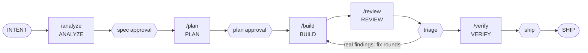

# Command reference

Every ANEW command on one page: what it does, what it reads and writes, where it stops, and how
lite and strict differ. This page is a map, not a second home for the rules — each entry points
at the file that defines it. Segment rules live in `workflows/segments.md`; when the two
disagree, that file wins and this page is out of date.

## Command map

The hexagons are the four human gates. `/new-feature` is the chainer: in lite it runs the whole
row above, asking at each gate; in strict it refuses and each role runs its own segment command.

Always available, outside the loop:

| Group | Commands |
|---|---|
| Terminal scripts | `scripts/init` · `scripts/doctor` · `scripts/check` · `scripts/residue` · `scripts/selftest` · `scripts/gemini-devam.ps1` |
| Request lanes | `/change` (existing behavior) · `/fix-bug` (broken behavior) · `/refactor` (structure only) |
| Setup · record · recover | `/bootstrap` · `/adr` · `/recover` |

## How to read this page

Every command has the same fields:

- **What it does** — one or two lines.
- **When to use it** — the situation it is for.
- **Reads / writes** — the files it uses. Context lives in files, so this is where to look.
- **Stops at** — the gate, and the human decision it waits for.
- **Lite / Strict** — the behavioral difference, or "no difference".
- **Refusal** — the entry-check message, quoted verbatim from the source file, or "none".
- **Common mistake** — one sentence.

Mode is the `Mode:` line in `AGENTS.md`, set at bootstrap (`workflows/README.md`, Modes).

## A — Terminal scripts

### `scripts/init`
- **What it does:** installs one AI tool adapter into the repo root: `claude-code`,
  `github-copilot`, `cursor`, `codex`, `antigravity` or `generic`.
- **When to use it:** once, before `/bootstrap`; again to add or refresh an adapter.
- **Reads / writes:** reads `adapters/<tool>/`; writes `CLAUDE.md` + `.claude/`, or `.github/`
  (`copilot-instructions.md`, `prompts/`, `agents/`, `instructions/`), or `.cursor/` (`rules/`,
  `commands/`), or `.agents/skills/` (Codex or Antigravity — one shared folder: the first installed
  wins, the other's same-named files are kept). Existing files are kept unless `--force`; `generic`
  writes nothing.
- **Stops at:** no gate; it prints the next step (`Next: open Claude Code here and run /bootstrap`).
- **Lite / Strict:** no difference — it runs before a mode exists.
- **Refusal:** an unknown adapter prints `Unknown adapter: <name>` and the usage (exit 1).
- **Common mistake:** `--force` over adapter files you customized — they are overwritten.

### `scripts/doctor`
- **What it does:** workspace health — required core files, recovery catalog, configuration
  (`AGENTS.md`, mode, language, `scripts/check.conf`), the ANEW base version (`.anew-version`),
  adapter presence and parity, this page's coverage, spec/plan gate consistency, twin and shipped specs, `specs/done/` immutability,
  evidence hygiene, fast-only evidence, criterion-map names no file holds (WARN). `--strict` turns gate warnings into failures; CI runs it that way.
  Step prerequisites (`requires` lines in `check.conf`): runs each distinct command once and
  prints, per profile, `runnable on this machine` or `not runnable on this machine (steps: …)`
  — a WARN in every mode, also under `--strict`: it describes the machine (R-13). A malformed
  `requires` line (or one naming no step) is a WARN, and each profile then reads `check fails on
  the check.conf errors above` — a conf error to fix, not an environment gap.
  New ships (specs added to `specs/done/` vs the base ref; fail closed — a line with a checkbox
  followed by an `AC-`/`CB-`/`PB-` id, only punctuation or emphasis between, is a criterion; its
  first box decides; a box in backticks still counts): an unchecked criterion without
  `→ moved to B-<n> | spec <NNNN>` (target existing), or any move in a sensitive-area spec, is a
  gate (tick a proven criterion `[x]`); a spec target must be open (`specs/active/`). A
  `Self-critique: pending` warns on a Draft — expected until the self-critique is approved — and
  is a gate past approval. Locally the base is HEAD, so only an uncommitted ship is seen; CI on a
  pull request sees every new ship.
- **When to use it:** after bootstrap, before a PR, whenever the workspace feels off.
- **Reads / writes:** reads the working tree (and git, for `specs/done/` against a base ref);
  writes nothing itself; runs the project's prerequisite commands (side-effect free by contract).
- **Stops at:** exit 0 = healthy (warnings allowed), exit 1 = broken; `FAIL` / `WARN` lines say why.
- **Lite / Strict:** no difference. The `--strict` flag is not strict mode; the two are independent.
- **Refusal:** none — it reports.
- **Common mistake:** reading a local gate `WARN` (spec/plan consistency) as harmless — under
  `--strict`, in CI, it is a `FAIL`.

### `scripts/check`
- **What it does:** the single verification contract — runs the steps in `scripts/check.conf` in
  order, fail fast. `--fast` runs only the steps tagged `[fast]`. Before the first step it runs
  the prerequisites (`requires <step>: <command>`) of the profile's steps, once per command.
  **Fast green is a working state; only full green is evidence.** (`docs/testing.md`, Two speeds,
  one contract)
- **When to use it:** `--fast` while iterating, and before a push together with the touched
  area's full-only tests (`docs/testing.md`, Two speeds, rule 8); plain `./scripts/check` at every
  handoff, PROVE step, ramp exit and in CI. When CI runs full on the pushed commit, that run is
  the handoff's full green (rule 6) — not a second local full run.
- **Reads / writes:** reads `scripts/check.conf` (format: `scripts/check.conf.example`); writes
  only what its steps write.
- **Stops at:** `CHECK GREEN (full, n steps, t s)` (exit 0) or `CHECK FAILED (full) at step: <name>` (exit 1).
- **Lite / Strict:** no difference.
- **Refusal:** `check: no scripts/check.conf yet.` (exit 1); an unknown argument prints the
  usage (exit 2); an unmet prerequisite: `CHECK FAILED (<profile>) prerequisite not met: <command>
  (steps: …) — environment gap, …(R-13)` before any step (exit 1); a malformed `requires` line:
  `CHECK FAILED (<profile>) requires names no step: <name>`, `… requires has no command: <step>`
  or `… requires line has no ':': <line>` (exit 1).
- **Common mistake:** citing `CHECK GREEN (fast, …)` as evidence.

### `scripts/residue`
- **What it does:** the residue test (`docs/testing.md`, Resource hygiene) — runs check twice and
  names every process check left running, judged by its parent chain. What other sessions or the
  OS started meanwhile is listed as `not from check` with its parent and never fails it. Memory
  is reported, not judged (a drop over `ANEW_RESIDUE_MB` is marked informational). `--fast` tests
  the fast profile.
- **When to use it:** at bootstrap and whenever `scripts/check.conf` changes (BUILD's Done), both
  profiles. The agent runs it; the gate shows one line, `Residue: clean (fast + full)`.
- **Reads / writes:** runs `scripts/check`; writes only a temp dir, deleted on exit.
- **Stops at:** `RESIDUE CLEAN (<profile>, 2 runs)` (exit 0) or `RESIDUE FOUND (<profile>)` (exit 1).
  A `check.conf` without steps: `RESIDUE NOT MEASURED (<profile>)` (exit 0) — never evidence of clean.
- **Lite / Strict:** no difference.
- **Refusal:** a red check stops it: `RESIDUE TEST ABORTED (<profile>): check failed in run <n> — the residue test needs a green check`.
- **Common mistake:** writing it into a spec as an acceptance criterion — it is BUILD's duty when
  check.conf changes; or asking a human to idle the machine — attribution makes that unnecessary.

### `scripts/selftest`
- **What it does:** proves that `scripts/check`, `scripts/doctor` and `scripts/residue` behave as
  documented, scenario by scenario.
- **When to use it:** after changing any ANEW script; CI runs it after doctor.
- **Reads / writes:** copies the ANEW core into a temp dir outside the repo; writes nothing in the repo.
- **Stops at:** `== selftest: <n> passed, <m> failed ==` (exit 1 on any failure).
- **Lite / Strict:** no difference.
- **Refusal:** none.
- **Common mistake:** editing a script and the selftest together to make it pass — a red selftest
  means the script now differs from its documentation.

### `scripts/gemini-devam.ps1`
- **What it does:** proje betiği (spec 0027) — Claude'un hakkı bittiğinde işi Gemini (Antigravity
  CLI, `agy`) ile sürdürür. `agy`'yi önce PATH'te, sonra `%USERPROFILE%\.gemini\bin\agy.exe`'de arar,
  depo kökünde etkileşimli açar; açılış talimatı branch'i, aktif spec'leri ve `Status`'larını, planın
  onay satırını ve bitmemiş ilk adımını, `git status`'u ve `.claude/handoff.local.md` devir notunu
  okutur ve sıradaki segment komutunu önerir.
- **When to use it:** Claude'un kullanım hakkı bittiğinde, PowerShell'de (herhangi bir klasörden):
  `scripts\gemini-devam.ps1`. `-Prova` Gemini'yi açmadan bulunan yolu, klasörü ve argümanları yazar.
- **Reads / writes:** kendisi okumaz, yazmaz, sır okumaz; Gemini'yi varsayılan izin modunda açar
  (her işlem için onay sorar; `--dangerously-skip-permissions` ve `--mode` verilmez).
- **Stops at:** Gemini'nin durum özeti ve önerisi; onay gelene kadar Gemini hiçbir şey başlatmaz.
- **Lite / Strict:** fark yok — Gemini `AGENTS.md`'deki modu uygular.
- **Refusal:** `agy` iki konumda da yoksa `Gemini (Antigravity CLI, agy) bulunamadı; Gemini
  açılmadı.`, aranan iki konum ve kurulum ipucu (exit 1).
- **Common mistake:** Gemini'de PLAN için `/plan` yazmak — yerleşik komuttur; `/anew-plan` kullanılır.
  Yürütme ilkesi betiği engellerse: `powershell -ExecutionPolicy Bypass -File scripts\gemini-devam.ps1`.

## B — Start: `/bootstrap` and `/new-feature`

### `/bootstrap`
- **What it does:** adapts ANEW to your project through an interview — language, inspect,
  interview, generate, verify, report (`workflows/bootstrap.md`). An empty tree takes the
  greenfield flow; existing code takes the adoption flow (stack and conventions detected from the
  code, confirmed rather than asked; flag changes proposed, never imposed).
- **When to use it:** once per project, right after `scripts/init`; rerun to revise.
- **Reads / writes:** reads `AGENTS.md`, `prompts/bootstrap.md` and the working tree; writes
  `docs/*.md`, `scripts/check.conf`, the `Mode` and `Language` lines and the project summary in
  `AGENTS.md` (invariant rules kept verbatim).
- **Stops at:** language · interview answers · the final report, where you approve the workspace.
  The report ends with the first command for the mode.
- **Lite / Strict:** it sets the mode; it runs the same in both.
- **Refusal:** none.
- **Common mistake:** skipping the VERIFY step's residue test — a bootstrap that fails it is not done.

### `/new-feature`
- **What it does:** the chainer, not a segment. Reads `Mode` from `AGENTS.md` first.
  Rule: **Segments always stop; /new-feature flows only as far as the mode allows.**
- **When to use it:** lite — every new feature starts here.
- **Reads / writes:** `AGENTS.md`, `workflows/segments.md`; then whatever each segment reads and writes.
- **Stops at:** spec approval · plan approval · triage · ship, continuing only on explicit approval.
  A matching spec in `specs/active/` is resumed from its next gate, never twinned.
  One-pass review: outside a sensitive area and with no criterion that needs the code broken on
  purpose, a clean `/review` carries `/verify` in the same independent session; the gates stay
  (`workflows/segments.md`, "The chainer").
- **Lite / Strict:** lite chains `/analyze` → `/plan` → `/build` → `/review` → `/verify`;
  strict refuses before any stage; unset stops (bootstrap has not run).
- **Refusal (strict, in the chat language, command names verbatim):** "Mode is strict: stages are
  role-owned. Analyst starts with /analyze; subsequent roles run /plan, /build, /review, /verify in
  their own sessions."
- **Common mistake:** expecting it to flow past a gate — it asks at every one, in every mode.

## C — The five segment commands

Each runs one segment of `workflows/segments.md`: entry check from files, work with its prompt,
gate, handoff ending in `Next: <segment> — <who runs it>`, stop.

### `/analyze`
- **What it does:** intent → clarify → spec (with self-critique) → spec approval.
- **When to use it:** strict — the Analyst starts a feature; lite — to resume at this gate.
- **Reads / writes:** `prompts/clarify.md`, `prompts/spec.md`, `specs/active/`, `specs/done/`,
  `specs/plans/` (for the next number); writes `specs/active/NNNN-<name>.md` and sets
  `Status: Approved`.
- **Stops at:** spec approval — "no open questions remain" · `Next: PLAN — Developer`.
- **Lite / Strict:** lite folds clarify into the draft and the approval is a quick yes/no — never
  skipped; strict clarifies first, then drafts. A sensitive area (`docs/domain.md`) clarifies
  first in lite too.
- **Refusal:** no fixed message — a matching spec in `specs/active/` is offered for resuming; a
  second spec for the same work is never opened.
- **Common mistake:** asking it for a plan — it never produces one.

### `/plan`
- **What it does:** a plan from the Approved spec, then plan approval recorded in the plan.
- **When to use it:** after spec approval; again to revise a plan.
- **Reads / writes:** reads `specs/active/NNNN-*.md`, `prompts/plan.md`; writes
  `specs/plans/NNNN-plan.md` with `Approved by / on: <name>, <YYYY-MM-DD>`.
- **Stops at:** plan approval · `Next: BUILD — Developer`. It writes no code.
- **Lite / Strict:** no difference in checks or gate; in strict, the Developer runs it in a new session.
- **Refusal:** "Spec not approved — run ANALYZE or get approval first."
- **Common mistake:** approving in chat — only the filled `Approved by / on` line counts.

### `/build`
- **What it does:** implements the approved plan until `./scripts/check` is green.
- **When to use it:** after plan approval; again to resume an `In progress` build, or for fix
  rounds after triage (`prompts/build.md §fixes`).
- **Reads / writes:** reads `specs/plans/NNNN-plan.md`, the spec, `prompts/build.md`; writes code
  and tests and sets the spec to `Status: In progress`.
- **Stops at:** changed files vs. the plan list (as amended) + real `./scripts/check` output ·
  `Next: INDEPENDENT REVIEW — fresh session / read-only reviewer`. A deviation goes to R-07.
- **Lite / Strict:** no difference in checks; in strict, a session of its own.
- **Refusal:** "Plan not approved — run PLAN and get the approval recorded first."
- **Common mistake:** reviewing its own build — the producer never verifies its own work.

### `/review`
- **What it does:** an independent, read-only review of the diff against the spec.
- **When to use it:** after a build, and again on a fix diff with a Medium or higher finding
  (in a sensitive area: every fix diff) — never on a fix diff that touches documentation only.
- **Reads / writes:** reads the diff, the spec in `specs/active/`, its plan in `specs/plans/`
  (file list, criterion ↔ test map), `prompts/review.md`; writes nothing.
- **Stops at:** the findings report, verbatim · `Next: TRIAGE — human (real / noise / defer / investigate); then Developer fix rounds, then VERIFY`.
  A clean one-pass review (lite, `workflows/segments.md`) also carries the evidence table ·
  `Next: TRIAGE — human (confirm the clean verdict and the evidence table); then SHIP`.
- **Lite / Strict:** no difference — independent review is never optional, in any mode: a
  read-only reviewer (the `reviewer` subagent in Claude Code) or a fresh session.
- **Refusal:** none — a soft check: without a branch/diff and a spec `In progress`, it says so and asks.
- **Common mistake:** fixing findings in the same step — triage comes first, and it is the human's.

### `/verify`
- **What it does:** QA — maps every acceptance criterion to evidence (`docs/testing.md`,
  Evidence policy).
- **When to use it:** after triage is complete. Not needed after a clean one-pass review, whose
  report already holds the table (lite, `workflows/segments.md`).
- **Reads / writes:** reads the spec, the plan (criterion ↔ test map, `## Triage`), `prompts/verify.md`, test output; writes no production code.
- **Stops at:** the criterion ↔ evidence table · `Next: SHIP — human (DoD, tick the proven criteria, move spec to specs/done/ with Status: Shipped in the PR, merge)`.
- **Lite / Strict:** no difference; in strict, QA in a fresh session.
- **Refusal:** none — a soft check: with no triage record in the plan's `## Triage`, it says so and asks.
- **Common mistake:** a claim without evidence in the table — that is a gap, and gaps are findings.

## D — Request lanes: `/change`, `/fix-bug`, `/refactor`

### `/change`
- **What it does:** changes a behavior that already exists. Triage first, three questions in
  order (`workflows/change-request.md`): (a) deviation from what was agreed? → BUG;
  (b) does an acceptance criterion change or appear? → CHANGE, else TRIVIAL;
  (c) does it touch shared code? → CHANGE. Three lanes: BUG → `/fix-bug` · TRIVIAL → one narrow
  commit per the `docs/git.md` "Trivial changes" policy · CHANGE → mini-spec from
  `specs/TEMPLATE-mini.md` (`Source:` mandatory, changed + preserved criteria).
- **When to use it:** any request to change existing behavior, however small it sounds.
- **Reads / writes:** `workflows/change-request.md`, `docs/git.md`; writes a mini-spec in
  `specs/active/` (CHANGE) or one commit (TRIVIAL).
- **Stops at:** the triage verdict, which you confirm; then the lane's gates.
- **Lite / Strict:** strict runs only ANALYZE (mini) and stops at `Next: PLAN — Developer runs /plan <NNNN>`;
  lite chains the lane, asking at every gate — the plan gate is never skipped; a one-pass review
  may join `/review` and `/verify` (`workflows/segments.md`, "The chainer").
- **Refusal:** none — an open spec with the same `Source:` key is offered for resuming.
- **Common mistake:** triaging by how small the request sounds instead of by the behavior test.

### `/fix-bug`
- **What it does:** the bug-fix workflow (`workflows/bug-fix.md`): report → red reproduction test →
  diagnose → fix → prove → review → ship. No fix before a failing minimal reproduction test.
- **When to use it:** the behavior deviates from what was agreed (triage question (a)).
- **Reads / writes:** reads the report and `workflows/bug-fix.md`; writes the reproduction test
  (permanent) and the fix.
- **Stops at:** the reproduction (or a reasoned close) · triage of the fix review.
- **Lite / Strict:** no difference — triage is a human gate in every mode.
- **Refusal:** none — but no fix is written before the reproduction test is red.
- **Common mistake:** a fix that changes behavior — that is the CHANGE lane, mini-spec first.

### `/refactor`
- **What it does:** structure changes, behavior provably unchanged (`workflows/refactor.md`). The
  spec is a mini-spec: Changed behavior = *none — no observable behavior change*; Preserved
  behavior = the characterization criteria.
- **When to use it:** cleaning up structure without changing what the code does.
- **Reads / writes:** `workflows/refactor.md`, `specs/TEMPLATE-mini.md`; writes
  `specs/active/NNNN-refactor-<name>.md`, a plan, characterization tests (if missing), the refactor.
- **Stops at:** approval of spec and plan · triage of the review.
- **Lite / Strict:** no difference.
- **Refusal:** none — but `./scripts/check` must be green before it starts.
- **Common mistake:** editing a test — a needed test edit means behavior changed; stop.

## E — Record and recover: `/adr`, `/recover`

### `/adr`
- **What it does:** discusses an architecture decision, then records it from
  `docs/decisions/TEMPLATE.md` (`docs/decisions/README.md`).
- **When to use it:** a significant, hard-to-reverse choice — when it is made.
- **Reads / writes:** `prompts/adr.md`; writes `docs/decisions/NNNN-<slug>.md`.
- **Stops at:** your decision, before anything is written.
- **Lite / Strict:** no difference.
- **Refusal:** none.
- **Common mistake:** changing an accepted ADR's decision in place — a new decision gets a new ADR.

### `/recover`
- **What it does:** picks the matching recovery ramp, says which and why, then runs its prompt.
- **When to use it:** something went wrong — a red build, a drifting plan, a foggy context.
- **Reads / writes:** `prompts/recovery/README.md` and the ramp's file; writes what that ramp allows.
- **Stops at:** your confirmation of the ramp; then the ramp's own rules.
- **Lite / Strict:** no difference.
- **Refusal:** none — no match is treated as R-10 (ambiguity).
- **Common mistake:** improvising a fix instead of naming the ramp.

## Recovery ramps

Ramps are safe returns to the loop, not alternatives to it — each carries its own protection
rules. The agent names the ramp's code and asks the human to run it; the catalog, R-01…R-13,
lives in [`prompts/recovery/README.md`](../prompts/recovery/README.md).

## E — Application commands (CrytoBot CLI)

- `python -m crytobot prepare` — paper deposunu açılış bakiyesiyle oluşturur.
- `python -m crytobot prepare --live` — canlı depoyu borsanın serbest USDT bakiyesiyle oluşturur (spec 0033). Depo varsa hiçbir şey yazmaz. Spec 0036'dan önce açılmış (gerçek dolum bilgisi taşımayan) canlı depoyu `start --live`, `status` ve diğer komutlar `eski canlı depo` diye reddeder: bot dosyayı silmez; eski dosya kenara alınıp `prepare --live` ile yeniden açılır. İşletim notu (spec 0036 G-3): spec 0037 ship edilene kadar Binance hesabında "komisyonu BNB ile öde" kapalı olmalıdır; açıksa her dolum güvenli moda geçirir (`UNSUPPORTED_FILL`).
- `python -m crytobot start` — BR-10 aşama onayı ve geçerli backtest raporuyla kanıtlı başlatma. Yapılandırmada `[reporting.telegram]` etkinse (`enabled = true`, bot token ve chat id tanımlı) döngü süresince anlık işlem dolumları, risk durdurma halleri ve UTC 00:00 günlük özet raporu Telegram üzerinden bildirilir; yapılandırma eksik veya kapalıysa bildirimsiz çalışır.
  Rapor kapısı retleri (spec 0040; paper ve `start --live`, testnet dahil; depo yazılmaz, borsaya istek gitmez, çıkış 1): `ayar eksik | ayar geçersiz: stage.report_sha256`, `rapor onaylanandan farklı`, `rapor eksik: üretim anı | spread | strateji | <koşul>`, `onay rapordan önce`, `onay gelecekte`, `ayar eksik | ayar geçersiz: backtest.spread`, `ayar uyuşmazlığı: <koşul>`. Spec 0042: kapı yalnız son değerlendirme raporunu (`backtest --final`) kabul eder — `rapor son değerlendirme değil`, `rapor aday işareti taşımıyor` ("aday yok"), strateji adı farklıysa `ayar uyuşmazlığı: strateji` (parametre farkı yine `ayar uyuşmazlığı: <parametre>`). Spec 0043: kapı çalışan adayın (S0…S3) bütün parametrelerini (L, N, aşırı satım eşiği, k dahil) ve aralığını karşılaştırır — `ayar uyuşmazlığı: <parametre>`, `ayar uyuşmazlığı: candle_interval`; rapor çalışan adayın adını taşıyıp onun bir parametresini eksik bırakırsa `rapor eksik: strateji`. Strateji seçimi retleri (`prepare`, `start`, `backtest`; depo yazılmaz, borsaya istek gitmez, çıkış 1): `ayar geçersiz: strategy.name` (bilinmeyen aday), `ayar eksik: strategy.<alan>` (seçilen adayın anahtarı), `bilinmeyen ayar: strategy.<alan>` (başka adayın anahtarı), `ayar geçersiz: market.candle_count` (mum sayısı adayın en uzun göstergesine yetmiyor).
- `python -m crytobot start --trial` — BR-10 kapısını atlar; deneme işaretiyle (`TRIAL_MARK`) başlatır.
  Her paper başlatması (kanıtlı ya da `--trial`) depo hazır olduktan sonra, ilk turdan önce depoya bir başlatma kaydı yazar; yazılamazsa `başlatma reddedildi: başlatma kaydı yazılamadı` (çıkış 1). `--trial` kaydı o depoyu canlı geçiş kanıtı olmaktan çıkarır (spec 0038).
- `python -m crytobot start --live` — canlı başlatma: çift kilit, `[stage]` onay ve rapor kapıları, ardından paper kanıtı (spec 0038, BR-10), en son kimlik ve yetki denetimi. Paper kanıtı reddi borsaya istek göndermez, canlı depoya dokunmaz, çıkış 1: `paper kanıtı: paper deposu yok | paper deposu kullanımda | paper deposu live modunda | paper deposu canlı deponun kendisi | depo okunamıyor… | depo bozuk (mutabakat tutmuyor) | başlatma kaydı yok | deneme koşusu var | başlatma kaydı eksik | rapor uyuşmazlığı`, `paper eşiği karşılanmadı: paper_min_days | paper_min_trades | net kâr sıfırdan büyük olmalı | max_drawdown`, `stage.live_approved_at: onay paper sonucundan önce | onay gelecekte`. Geçen başlatmanın satırı `paper=<yol> gün=<n> işlem=<n> net=<x> açık=<n>` ekini taşır. Testnet'te aynıdır.
- `python -m crytobot download` — geçmiş veriyi indirir (`[history]`).
- `python -m crytobot backtest` — geçmiş veride stratejiyi yalnız örneklem içi dönemde (`[start, split_at)`) koşturur ve raporu yazar (`[backtest]`; spec 0042). Rapor ve konsol örneklem dışından ve saklı dönemden tek rakam taşımaz; bu rapor aşama kapısına girmez. Rapor başlığı üretim anını ve koşulları taşır; dosya yazılınca konsola `rapor parmak izi: <sha256>` satırı basılır (spec 0040). Dönem retleri (tur atılmaz, rapor yazılmaz, çıkış 1): `ayar eksik: backtest.holdout_at`, `ayar geçersiz: backtest.split_at | backtest.holdout_at` (sırasız, veri aralığı dışında ya da bir dönemi boş bırakan tarih).
- `python -m crytobot backtest --final` — son değerlendirme (spec 0042): ayar kombinasyonu örneklem içi sonuçla seçilir (en az 30 kapanmış işlem, en yüksek kâr faktörü), seçilen kombinasyon örneklem dışı ve saklı dönemde kodda sabit eşiklerle değerlendirilir (örneklem dışı: net kâr > 0, kâr faktörü ≥ 1.2, ≥ 30 işlem, drawdown < %15; saklı dönem: net kâr > 0, drawdown < %15). Rapor ilk satırında `son değerlendirme` der, `sınanan kombinasyon: N`, `paper adayı: <ad> <aralık> | aday yok` ve her aday için `sonuç: geçti | geçmedi: <ilk tutmayan eşik> (<değer> <işaret> <eşik değeri>)` yazar (spec 0043 R-6, ör. `geçmedi: örneklem içi işlem yetersiz (29 < 30)`); paper adayı varsa onun örneklem içi, örneklem dışı (BR-10 kanıtı adayı), saklı dönem ve tüm koşu bölümleri. Parmak izi satırı ve çıkış kodları `backtest` ile aynı; bu değer `[stage] report_sha256`'ya yazılır. Spec 0043: `[backtest] final_data = { "1h" = "<yol>", "4h" = "<yol>" }` ile iki aralık ve her aralıkta sabit ızgara (S0…S3 × 9, toplam `sınanan kombinasyon: 72`) tek raporda; tek paper adayı bütün aday ve aralıklar arasından. Retler (tur atılmaz, rapor yazılmaz, çıkış 1): `ayar eksik: backtest.final_data`, `ayar geçersiz: backtest.final_data` (anahtar kümesi {1h, 4h} değil ya da yol depo, kayıt ya da rapor yolu), `ayar geçersiz: backtest.split_at | backtest.holdout_at` (4h sınırında değil), `ayar geçersiz: market.candle_count` (200 mumdan az); adaylar arası koşul farkı `ayar uyuşmazlığı: <ad>`. Spec 0044: veri dosyaları okunduktan sonra, hiçbir tur atılmadan, bir çiftin bir aralıkta bir dönemde hiç kapanmış mumu yoksa `veri eksik: <çift> <aralık> <örneklem içi | örneklem dışı | saklı dönem>` (ilk eksik: aralık 1h, 4h; çift dosya sırası; dönem sırası); iki aralığın dosyası farklı anda bitiyorsa `veri dosyası uyumsuz: aralıkların bitişi farklı` (tur atılmaz, rapor yazılmaz, çıkış 1). Dönemde tek mum yeterlidir. Rapor varsayımlardan sonra, adaylardan önce her aralık için `veri — <aralık>: dönem <başlangıç> .. <bitiş> (bitiş hariç), saklı dönemin son mumu <an>` satırını ve her boşluğu `<çift> <ilk eksik> → <son eksik> (<n> mum)` olarak zaman sırasıyla yazar (indirme özetinin `boşluk=` sayımıyla aynı kural); boşluk yoksa `veri boşluğu: yok`. Boşluk koşuyu durdurmaz, doldurulmaz; varsayılan `backtest` raporu değişmez.
- `python -m crytobot status` — botun süreç durumunu (çalışıyor/durdu), modunu, serbest bakiyesini, toplam kasasını, açık pozisyonlarını, günün kâr/zararını, zirve kasayı, drawdown oranını, aktif durdurmaları ve son tur özetini konsola basar (salt okunur). Depo canlıysa ilk satır `CANLI MOD — gerçek para`dır; ayardaki mod (`bot.mode`) ile deponun modu farklıysa deponun gerçek modu ve bir uyarı gösterilir (spec 0035).
- `python -m crytobot kill-switch` (veya `kill-switch on`) — yeni alımları anında durdurur ve kalıcı duruma işler; açık pozisyonların kapanışı engellenmez. Paper ve canlı depoda çalışır, API anahtarı istemez. Bot çalışıyorsa depoya doğrudan yazılmaz: istek `<depo>.kill` bayrağına gider ve bot onu en geç sonraki turun başında, alımdan önce kendi kaydıyla işler (bayrak çökme sonrası da kalır). Ayardaki mod ile deponun modu farklıysa deponun modunda uygulanır ve uyarı verilir (spec 0035).
- `python -m crytobot resume` — aktif kill switch ve/veya drawdown durdurmasını kaldırır, zirve kasayı son gözlenen kasaya günceller ve kaydeder. Bot çalışırken `çalışan bot var: önce stop` ile reddedilir; ayardaki mod ile deponun modu farklıysa da reddedilir (spec 0035).
- `python -m crytobot stop` — çalışan bot sürecine temiz durdurma isteği iletir; mevcut tur tamamlandığında bot döngüsü güvenle kapanır.
- `python -m crytobot dashboard` — localhost üzerinde salt-okunur web panosunu (`127.0.0.1:8080`) başlatır; tarayıcıdan anlık kasanın, drawdown oranının, açık pozisyonların ve son turların koyu temalı web arayüzünden izlenmesini sağlar (ADR 0002, spec 0031). Canlı depoda sayfanın ilk satırı `CANLI MOD — gerçek para`; `/api/status` `mode` ve `mode_mismatch` alanlarını taşır (spec 0035).

## Quick reference

| Command | One line | Stops at | Lite | Strict |
|---|---|---|---|---|
| `scripts/init` | Install an adapter | Prints next step | Same | Same |
| `scripts/doctor` | Workspace health; `--strict` in CI | Exit 0 / 1 | Same | Same |
| `scripts/check` | The verification contract; `--fast` to iterate | `CHECK GREEN` / `CHECK FAILED` | Same | Same |
| `scripts/residue` | Check leaves nothing running | `RESIDUE CLEAN` / `RESIDUE FOUND` / `RESIDUE NOT MEASURED` | Same | Same |
| `scripts/selftest` | ANEW's scripts behave as documented | Pass / fail count | Same | Same |
| `/bootstrap` | Adapt ANEW to the project | Language · interview · report | Sets the mode | Sets the mode |
| `/new-feature` | Chain the segments | Each of the four gates | Chains | Refuses |
| `/analyze` | Intent → approved spec | Spec approval | Clarify folded into draft | Clarify first |
| `/plan` | Approved spec → approved plan | Plan approval | Same | Own session |
| `/build` | Approved plan → green check | Handoff with check output | Same | Own session |
| `/review` | Independent, read-only review | Findings → triage | Same | Same |
| `/verify` | Criteria ↔ evidence | Table → ship | Same | Own session |
| `/change` | Triage, then the lane | Verdict; lane gates | Chains the lane | ANALYZE (mini) only |
| `/fix-bug` | Red reproduction first | Repro · triage | Same | Same |
| `/refactor` | Behavior unchanged, proven | Approval · triage | Same | Same |
| `/adr` | Record a decision | Your decision | Same | Same |
| `/recover` | Run the matching ramp | Ramp confirmation | Same | Same |

## Two golden rules

1. **Segments always stop.** Every segment ends at its handoff; only `/new-feature` (lite) moves on,
   and only after you approve.
2. **The four human gates — spec approval, plan approval, triage, ship — are never automated, in
   any mode.**

The same commands exist in Claude Code, Cursor, GitHub Copilot, Codex and Antigravity
(`./scripts/init <tool>`; in Codex they are skills, typed `$analyze` instead of `/analyze`; in
Antigravity PLAN is `/anew-plan`); any other tool uses the generic
adapter and pastes the prompts (`adapters/generic/README.md`). How strongly each rule holds per
tool is the README's "How strongly is each rule held?" table.
